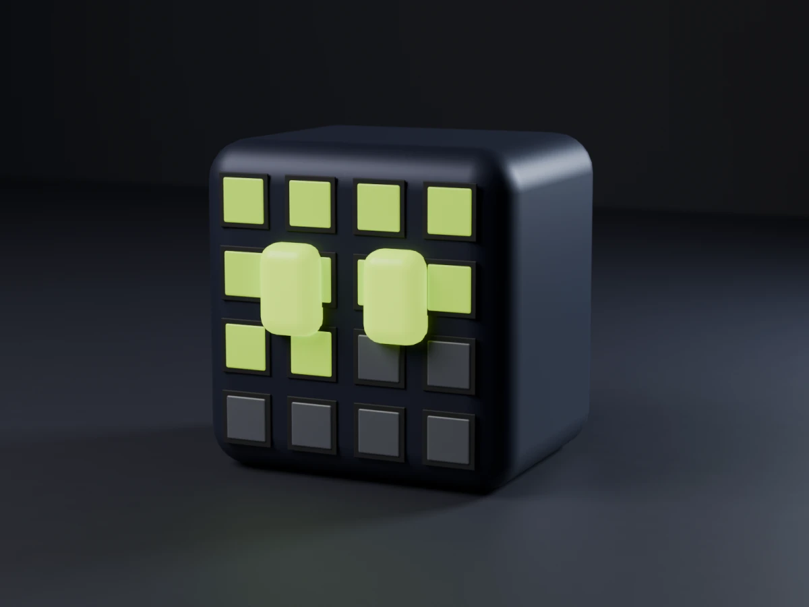
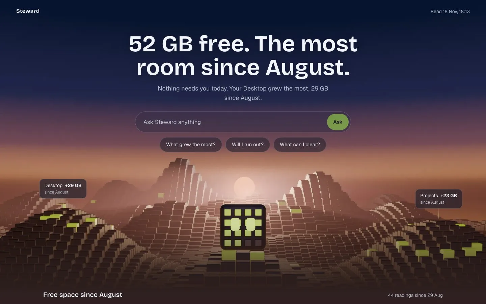
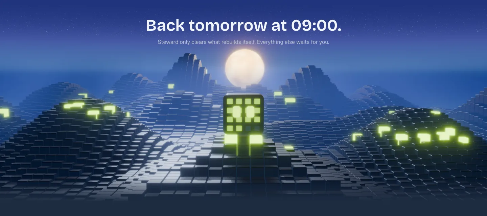
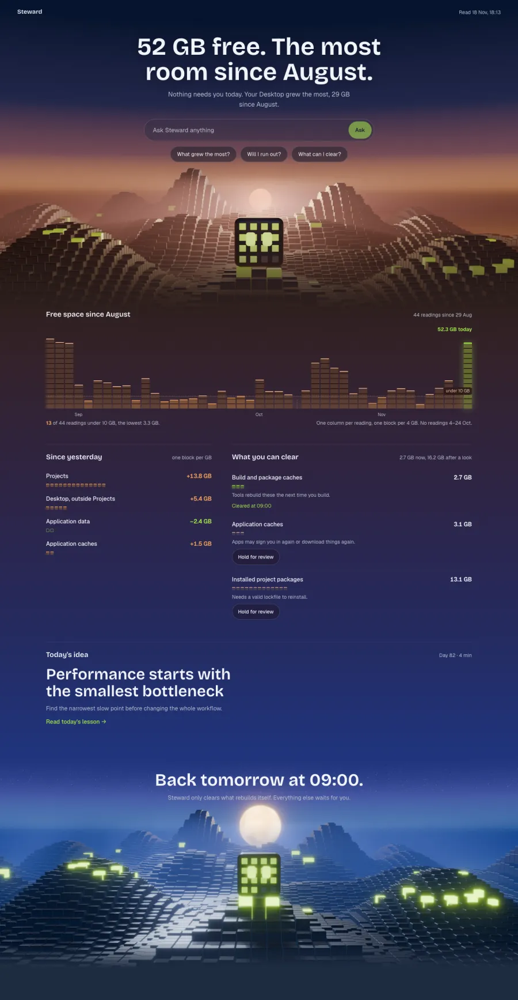
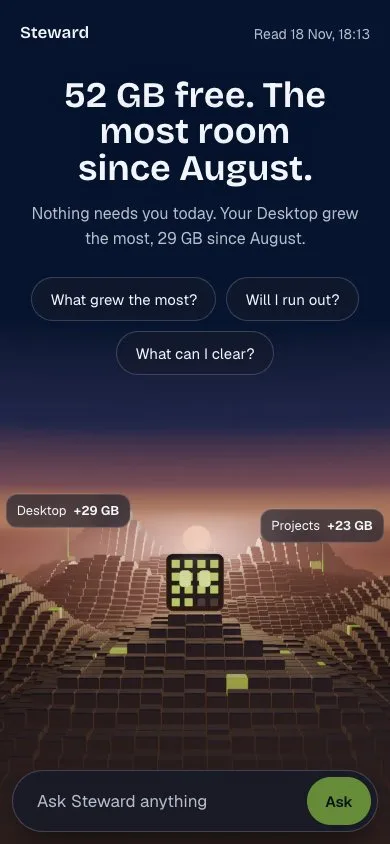

<p align="center"></p>

# Steward

A private, local-first operations brief for your Mac. Steward reads your disk once a day, says what changed and why, points at data that can safely be rebuilt, and never deletes anything on its own.

The character in the corner is the brief's voice. Its 4×4 grid is your real disk fill: ten lit cells means about 62 % used. It only says what the collector measured.

## The new brief: your disk as a land

<p align="center"></p>

One sentence answers "Am I OK?" before you scroll: **52 GB free. The most room since August.** Everything under it is evidence.

- **The land is your disk.** Every block in the Blender scene is real space. The lime ones are what Steward can rebuild for you. Desktop and Projects carry tags with what they gained since your first reading.
- **Ask it anything.** "What grew the most?", "Will I run out?", "What can I clear?" Each answer quotes the readings it comes from. Scroll past and the field docks at the bottom of the screen.
- **Every reading, one column.** 44 readings since August, one block per 4 GB, the days under 10 GB marked, and the three weeks with no readings left visible instead of drawn over.
- **Honest about clearing.** Caches that rebuild themselves are cleared at 09:00. Anything that could cost you a sign-in or a reinstall is held for your review, with what is inside it and how to get it back.
- **Truthful on every day.** On the first day there is nothing to compare, and it says so. When a reading is old, every number says which day it is from.
- **It ends at night.** The page runs from sunrise through sunset to the same land under the moon, with the lights still on.

<p align="center"></p>

<table>
<tr>
<td width="62%"></td>
<td width="38%" valign="top"><br><br><sub>Composed at every width from 320 to 1920 px. On a phone the Ask field sits at the bottom, within reach of your thumb. Motion is transform and opacity only, and with reduced motion it keeps only the fades.</sub></td>
</tr>
</table>

<sub>This is the design for the next version of the brief, made with headless Blender renders and a lab of captures, checks and reviews. The app in this repository still runs the current brief. The numbers in these images are categories from a real Mac's readings. No file or project names are shown.</sub>

## What it does

- **Daily snapshot.** Directory sizes, project names and classification metadata. It never reads document contents.
- **Changes, explained.** What grew since the last reading, and where.
- **Reclaimable, honestly.** Only `safe`, `low` and `rebuildable` items count. Anything riskier is held for your review.
- **Learn.** A seven-day field guide (RAM against SSD storage, and so on). Every interactive model in it is labelled as an example, not live data.

Scheduled scans are read-only. Deletion never happens automatically.

## Run

```sh
npm run demo      # optional: copy demo data so the brief renders before your first reading
npm run collect   # take a reading (observation only)
npm run dev       # open http://127.0.0.1:4173
npm test
```

`npm run collect:safe` is the explicit cleanup path: it scans, clears only allowlisted caches and generated build outputs, records a receipt, and scans again. `node_modules`, app caches and Xcode archives are never cleared.

## Your data stays on your machine

The collector writes to `public/data/` and `data/snapshots/`, both gitignored. The repository ships demo data with the same schema in `demo/data/`. Snapshots older than 90 days are removed by the collector. The optional assistant sends a structurally redacted context to a cloud model only after you opt in per provider; with no key set, nothing leaves the machine.

## The figure

`art/figure/steward.py` builds the character in Blender from the same numbers as the CSS dock (48 px body, 4×4 cells inset 5 px, 9×13 px eyes set off the cell rhythm):

```sh
Blender --background --python-exit-code 1 --python art/figure/steward.py -- \
  --look a --engine cycles --samples 128 --res 1600 --fill 62 --out steward.png
```

## Licence

MIT. See [LICENSE](LICENSE).
